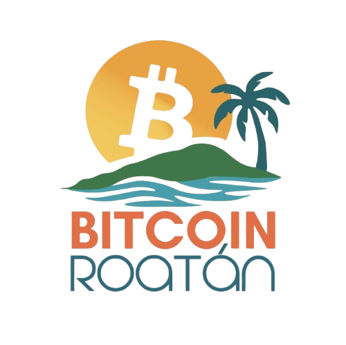
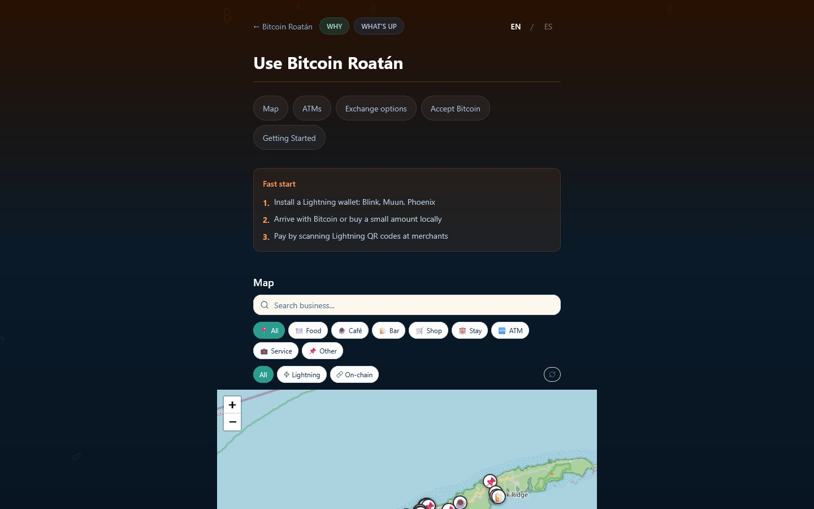

# Bitcoin Roatán 🏝️🟠

**A neutral, practical guide to using Bitcoin on Roatán, Honduras**

Where to spend it, where to get it, and who to ask. In English and Spanish. ⚡

[🌐 bitcoinroatan.info](https://bitcoinroatan.info) · [🗺️ The map](https://bitcoinroatan.info/use) · [🤔 Why Bitcoin](https://bitcoinroatan.info/why) · [📅 What's Up](https://bitcoinroatan.info/whatsup) · [💬 WhatsApp group](https://chat.whatsapp.com/FQ9Uu5WR6VOGgh5sPaSuFK)

 

---

## 👋 Hello!

[Roatán](https://en.wikipedia.org/wiki/Roat%C3%A1n) is an island off the north coast of Honduras with a growing Bitcoin community. This site is the plain answer to "I'm on the island, how do I use Bitcoin here?"

It is maintained by local organizations and volunteers. The aim is to be accurate and useful, not promotional. No hype, just facts. 🧡

This repository is the code of the site. If you are just visiting: **[open the guide](https://bitcoinroatan.info)**.

## 🚦 Status

**Live** at [bitcoinroatan.info](https://bitcoinroatan.info) (served from Cloudflare since 2026-10-26). The guide pages (Why, Use, What's Up, About) and the merchant map work today. The front page is still a "Coming soon" teaser with an email sign-up. At the last check the map listed 91 places.

## 🧭 What is on the site

- 🗺️ **Use.** A map of shops, restaurants, hotels and services that accept Bitcoin, with search and filters. Also Bitcoin ATMs, places to get Bitcoin, and a getting-started checklist for wallets (Lightning wallets such as Blink, Muun and Phoenix).
- 🤔 **Why.** Why Bitcoin matters on the island.
- 📅 **What's Up.** Events, community channels and links.
- ℹ️ **About.** The project and its partners.
- 🌎 **English and Spanish.** One click to switch.

## 🔗 Where the data comes from

- 🗺️ **Merchants:** [BTCMap](https://btcmap.org/map), a community map of Bitcoin-accepting places built on [OpenStreetMap](https://www.openstreetmap.org). The site keeps a copy of every Roatán place and pulls BTCMap changes automatically.
- 📅 **Events:** a community events calendar, shown on the What's Up page.
- 🏧 **ATMs, guides and texts:** written by hand in this repository, in English and Spanish.

## 🙌 How to help

- 📍 **A place is missing, closed or wrong on the map?** [Add or fix it on BTCMap](https://btcmap.org/add-location) and the site picks the change up. That is the best fix for merchants.
- ✍️ **A guide text, ATM detail or link is wrong?** [Open an issue](https://github.com/itstomekk/bitcoin-roatan/issues) or send a pull request. These corrections are the most useful.
- 🌎 **Better Spanish?** Translation fixes are welcome. The texts live in `src/contexts/LanguageContext.tsx`.
- 💬 **Live on the island or visiting?** Join the [community WhatsApp group](https://chat.whatsapp.com/FQ9Uu5WR6VOGgh5sPaSuFK) and say hi.

Build, API and deploy notes are in [DEVELOPMENT.md](DEVELOPMENT.md).

## 🤝 Related links

- 💬 [Community WhatsApp group](https://chat.whatsapp.com/FQ9Uu5WR6VOGgh5sPaSuFK)
- 📅 [The Bitcoin District events](https://thebitcoindistrict.com/events)
- 🎓 [Bitcoin Center Roatán (AmityAge Academy)](https://www.amityage.com/bitcoin-center-roatan)
- ⚡ [Blink wallet](https://blink.sv)

## 📜 License

[MIT](LICENSE)

---

🇪🇸 En español

**Bitcoin Roatán** es una guía neutral y práctica para usar Bitcoin en [Roatán](https://es.wikipedia.org/wiki/Roat%C3%A1n), Honduras. La mantienen organizaciones locales y voluntarios, y busca ser precisa y útil, no promocional.

🌐 **[Abrir la guía](https://bitcoinroatan.info)** (cambia a ES arriba a la derecha)

**Estado:** en línea. Las páginas de la guía y el mapa de comercios funcionan; la página de inicio sigue siendo un aviso de "Próximamente" con registro de correo.

**Cómo ayudar:** agrega o corrige comercios en [BTCMap](https://btcmap.org/add-location); si un texto, un cajero o un enlace está mal, [abre un issue](https://github.com/itstomekk/bitcoin-roatan/issues) o manda un pull request; y si estás en la isla, únete al [grupo de WhatsApp](https://chat.whatsapp.com/FQ9Uu5WR6VOGgh5sPaSuFK).

**Don't trust, verify.** ⚡ Hecho con 🧡 en Roatán.

